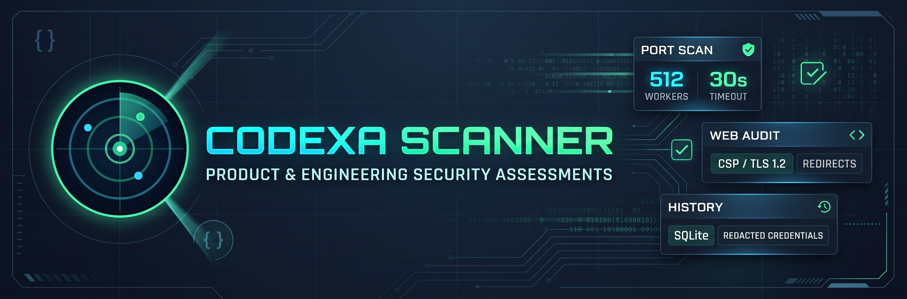

<p align="center">
  
</p>

# Codexa Scanner
Desktop network reconnaissance and HTTP security-header inspection application built with Go, Wails v2, React, and TypeScript. Developed by [H!D3-C4rD](https://arkaryan.net/).

> **Authorized-use notice:** Use only against systems you own or have explicit permission to assess. Port scanning and HTTP requests may be logged, trigger defensive controls, or violate policy or law when performed without authorization. Checks are passive and non-exploitative; results are indicators for review, not proof of exploitability or a substitute for a professional assessment.

## Features

- **Port Scanner**: Concurrent TCP port checks with capped worker count and connection timeout, live findings/progress, cancellation-aware status, and one stable target address per scan. IPv4/IPv6 literals and ASCII DNS hostnames accepted; URLs, ports, malformed names, and control characters rejected. Each scan requires explicit authorization confirmation for its exact target and selected port range. Authorized private/lab targets are not blanket-blocked. Best-effort service identification and **active protocol fingerprinting** (SSH banner, SMTP EHLO, TLS handshake with version/cipher, HTTP OPTIONS, Redis PING) with extracted protocol, version, TLS support, and negotiated cipher.
- **CIDR /24 Subnet Sweep**: Bounded live-host/port sweep with explicit scope confirmation, host-alive pre-check, reverse DNS lookup, per-host port scanning, pause/resume support, progress events, JSON export, history persistence, and **configurable RPS (0-50) and jitter (0-5000ms) rate limiting**.
- **Web Audit**: Bounded HTTP/HTTPS checks with redirect-chain disclosure (each hop shows status, source, destination), headers/cookies/TLS/mixed-content and CSP diagnostics, passive CORS/JWT posture clues (wildcard origin, wildcard+credentials, unsafe origin reflection), sampled DB-error disclosure, `security.txt`/`robots.txt` inspectors, and **bounded client-side exposure audit** (first-party JS secret-pattern clues with redacted previews, source-map reachability HEAD checks, API/BaaS endpoint extraction, DOM sink clues, harmless reflected-parameter indicator). **GraphQL/OpenAPI introspection** checks for `/graphql`, `/swagger.json`, `/openapi.json`. **Cloud storage bucket exposure** detection for AWS S3, GCS, Azure Blob with public listability checks. **Rate-limiting & cache-control audit** for sensitive endpoints (login, auth, api, password, token paths). **Webhook/OAuth posture** detection for Slack/Discord/Telegram/Teams webhooks and OAuth parameters (`client_id`, `redirect_uri`, `client_secret`, `scope`, `state`) with redacted evidence. **Attack surface mapper** extracting HTML forms (action/method/inputs/login detection), query parameters, third-party script origins, and localStorage/sessionStorage keys. JSON/HTML/Markdown/PDF exports, request delay control, RPS/jitter rate limiting, per-URL snapshot diff, and proxy/SOCKS5 routing.
- **Headless Web Audit CLI** (`audit --url ... --fail-on high --json report.json --sarif report.sarif`): Reuses target validation and bounded checks, writes redacted JSON/SARIF 2.1.0 reports, returns CI-friendly exit codes; private/loopback targets require explicit `--allow-private` flag. **Custom request headers** (`Authorization`, `Cookie`, `X-API-Key`) with automatic redaction before persistence/export. **Proxy/SOCKS5 routing** with http/https/socks5/socks5h schemes. **User-extensible YAML/JSON rule packs** (`--rules`) for custom secret patterns, header rules, and path wordlists.
- **Subdomain Discovery**: Certificate Transparency data with optional capped DNS wordlist lookup; discovered names can be sent to HTTP analyzer. **Subdomain takeover clues** for 15+ cloud providers (GitHub Pages, Heroku, Vercel, Netlify, AWS S3/CloudFront/Elastic Beanstalk, Azure, Surge.sh, Firebase, GitLab Pages, Shopify, Ghost, WP Engine, Fastly, Pantheon, Bitbucket Pages) with CNAME resolution status and remediation guidance.
- **Path Fuzzer**: HEAD-only bounded path checks with framework/env/API presets and request delay control, RPS/jitter rate limiting.
- **TLS Inspector**: Certificate trust/self-signed state, expiry, SANs, negotiated protocol/cipher, HTTP/2 ALPN, HTTP/3 `Alt-Svc` advertisements, and bounded TLS 1.2 legacy-cipher probes. TLS 1.0/1.1 probes report Supported (exact-version handshake), Not supported (explicit `protocol_version` alert), or Inconclusive (with probe error). **HTTP/2 via ALPN and HTTP/3 via Alt-Svc** detection.
- **DNS/Email Intelligence**: A, AAAA, MX, NS, TXT, SPF, DMARC, reverse PTR records; optional RDAP registration/country metadata. **Email security policy parser** with DKIM lookup (12 common selectors), SPF analysis (all mechanism, includes, redirects, weak mechanisms), DMARC analysis (policy, subdomain policy, pct, rua/ruf, alignment), DKIM analysis (key type, key size from base64 public key, selector count), overall email policy rating (strong/moderate/weak/missing).
- **IP Information**: Source-labeled public/private/special-use classification, reverse DNS, public-IP RDAP registration metadata; no geolocation inferred.
- **History & Reports**: Local SQLite history capped at 2,000 records with latest-two-scan port diff. History records selectable across targets and scan types for consolidated engagement JSON/PDF reports. Bounded redaction for embedded URL credentials, sensitive query/fragments, and sensitive result keys. **Search/filter/delete/clear actions with confirmations**. **Workspace persistence** (`workspaces` table + foreign key) for multi-client engagement isolation. **Analyst finding tags** (`Verified`, `False Positive`, `Needs Review`, `Accepted Risk`) and **notes** persisting in SQLite and carried into reports.
- **External Tool Import**: Nmap XML (`nmap -oX`) import populating open ports and queuing HTTP/HTTPS endpoints for Web Audit. Newline-delimited subdomain list import (subfinder, amass) with deduplication and validation. Workspace-targeted import with result summaries.
- **HTTP Inspector & Replay**: Raw request/response headers, body preview, TLS details, negotiated HTTP/2/HTTP/3, weak cipher warnings. Bounded replay with safe methods (GET, HEAD, OPTIONS) and modified headers within same host/port scope.
- **Global Rate Limiting**: Configurable RPS caps, random jitter delays, pause/resume lifecycle controls for Web Audit, Path Fuzzer, and CIDR sweep. Respects target rate limits.
- **Command Palette** (`Ctrl/Cmd+K`): Keyboard-driven navigation across modules, workspaces, and reports, with selectable User-Agent and timeout presets.
- **Bilingual Remediation Guide** (English/Myanmar): Embedded `go:embed` knowledge base mapping every finding rule ID to comprehensive explanations: mechanism, common developer mistakes, attack scenario walkthroughs, target file path and code location, before/after code diffs, deployment actions, verification instructions across stacks (Next.js, Laravel, Express, Nginx, Apache, Supabase). Auto-select detected tech stack tab, EN/မြန်မာ toggle, searchable Security Playbook view.
- **Shared, Versioned Report Model**: Bounded redaction for persistence, individual exports, history exports, and consolidated engagement reports.
- **Cross-platform Desktop UI**: Powered by Wails v2, Go, React, TypeScript.

## How it works

The React UI calls Go methods exposed by Wails. Before a port scan, the backend accepts only a bare IPv4/IPv6 address or ASCII DNS hostname, rejects URL/port syntax and malformed input, and requires the user to confirm authorization for the exact target and selected port range. Private and lab targets remain available when authorized; there is no blanket private-IP block. `StartPortScan` resolves a hostname once, with a five-second lookup timeout, then pins one deterministic address for the entire scan: IPv4 is preferred and addresses within a family are ordered numerically. A literal IPv4/IPv6 target skips DNS. When a name has multiple A/AAAA answers, only the selected address is scanned in that run, and the UI shows the pinned address. TCP connections use a bounded worker pool and per-connection timeout; reachable ports stream to the interface, and cancellation/completion/failure are reflected in scan status. The passive web analyzer issues bounded HTTP GET requests and reads up to 64 KiB per response for title, mixed-content and technology clues. Each submitted URL defines its own hostname/port scope: same-host redirects are allowed, HTTP on port 80 may upgrade to HTTPS on port 443, cross-host redirects and HTTPS-to-HTTP downgrades are blocked, and other port changes are rejected. DNS answers are checked in full and one deterministic address is pinned throughout the request chain; no environment proxy is used. Private RFC1918, IPv6 ULA, and loopback targets are blocked by default and require a one-shot opt-in, while link-local, multicast, unspecified, and special-use/reserved addresses remain blocked. TLS is validated with the system trust store. Security findings include severity, evidence and remediation guidance and can be exported as JSON. Subdomain lookups query crt.sh and are capped at 500 names; optional DNS label checks are bounded. Path discovery is limited to 500 candidate paths, sends HEAD only, follows no redirects and omits response bodies. TLS legacy-version checks are handshakes only. DNS results are saved locally; optional RDAP lookups contact the public RDAP service only for public IP addresses. Local history is kept in the OS user-configuration directory under `CodexaScanner/history.sqlite` and automatically pruned to the latest 2,000 records. The database is not uploaded by the app and is not encrypted; delete that file while the app is closed to clear history. On platforms supporting Unix-style permissions, access is restricted to the current user.

The risk score is a simple severity-weighted heuristic, not CVSS and not a formal risk score. The passive web-audit module does not authenticate, crawl linked routes, submit forms, test authorization, or exploit vulnerabilities. The separate path module is an active but bounded HEAD-only check; it does not fetch or display path response bodies. TLS 1.0/1.1 results are best-effort because the local Go crypto policy can prevent a legacy handshake independently of the remote server. RDAP country/network data describes registry records and is not precise geolocation or a guaranteed ASN mapping. Technology/WAF fingerprints may be incomplete or false positives. Port banners and server headers can be absent, incomplete, or deliberately misleading. A clean report does not mean a site is vulnerability-free.

## Build locally

Prerequisites: Go 1.22+, Node.js 20+, npm, and the platform prerequisites for [Wails v2](https://wails.io/docs/gettingstarted/installation/). Linux builds need GTK/WebKit development libraries. Windows builds should be run on Windows with WebView2 available.

```sh
npm install --prefix frontend
cd frontend && npm run build && cd ..
go mod tidy
wails build -platform linux/amd64
```

On macOS, Wails builds an application bundle. Build the architecture matching the Mac, or use the release DMG files:

```sh
wails build -platform darwin/arm64   # Apple Silicon
wails build -platform darwin/amd64   # Intel
```

For development, run `wails dev` from the repository root after installing dependencies. Wails CLI installation instructions are available in the official Wails documentation.

## Documentation

Start with the [User Guide](docs/user-guide.md). Feature-specific documentation is available for the [Port Scanner](docs/port-scanner.md), [Web Audit](docs/web-audit.md), [Headless CLI](docs/cli.md), [Subdomain Discovery](docs/subdomain-discovery.md), [Path Fuzzer](docs/path-fuzzer.md), [TLS Inspector](docs/tls-inspector.md), [DNS Intelligence](docs/dns-intelligence.md), [IP Information](docs/ip-information.md), and [History and Reports](docs/history-and-reports.md). The complete documentation index is in [`docs/README.md`](docs/README.md).

## CI artifacts and releases (v1.1.5)

GitHub Actions (`.github/workflows/build.yml`) runs on pushes to `main`, pull requests, and version tags (`v*`).

- **Permissions:** least-privilege by default (`contents: read`); only the tag-release job is granted `contents: write`.
- **Linux (`ubuntu-22.04`):** builds the app, runs `go test -race ./...` and `go vet ./...`, and packages `CodexaScanner_1.1.5_amd64.deb`.
- **Windows (`windows-latest`):** builds portable `CodexaScanner.exe` and runs `go test ./...` and `go vet ./...`.
- **macOS:** builds both Intel (`amd64`, `macos-13`) and Apple Silicon (`arm64`, `macos-15`) application bundles, then packages `CodexaScanner-amd64.dmg` and `CodexaScanner-arm64.dmg`.
- **Release (tag `v1.1.5` / `v*`):** attaches `.deb`, `.exe`, and both `.dmg` assets to a GitHub Release with generated notes.

The macOS DMGs are currently unsigned and not notarized. On a clean Mac, open the DMG, drag **CodexaScanner.app** to **Applications**, then use **Open** from the Finder context menu the first time if Gatekeeper blocks the unsigned app.

Frontend dependencies are pinned with a committed lockfile to reduce build drift. Download build artifacts from the Actions run or the GitHub Release assets. For clean-machine install/upgrade/uninstall and SQLite history data-retention verification steps, see [docs/release-verification.md](docs/release-verification.md).

## Repository topics

`codexa-scanner`, `security`, `network-scanner`, `port-scanner`, `http-security`, `wails`, `golang`, `react`, `typescript`, `reconnaissance`

## Disclaimer

This software is provided for authorized testing, education, and defensive security work. You are responsible for obtaining permission, complying with applicable laws, and respecting target scope and rate limits. The authors accept no liability for misuse or damage.

### Latest Threat & CVE Feed (P10.4 upgrade)

Version 1.1.5 adds an explicit **Sync Latest CVEs** action. It fetches the public CISA KEV JSON feed and recent Critical/High CVEs from the NVD 2.0 API without an API key, using a 15-second timeout. Results are stored in the local `history.sqlite` database (`cve_feed` table), shown on the Dashboard for the last 7 or 30 days, and remain available offline. Sync never runs automatically at application startup; if either remote source is unavailable, the bundled `knowledge/advisory.json` and previously cached feed are retained. Cached versioned advisories are also considered by the passive matcher after a successful sync.
